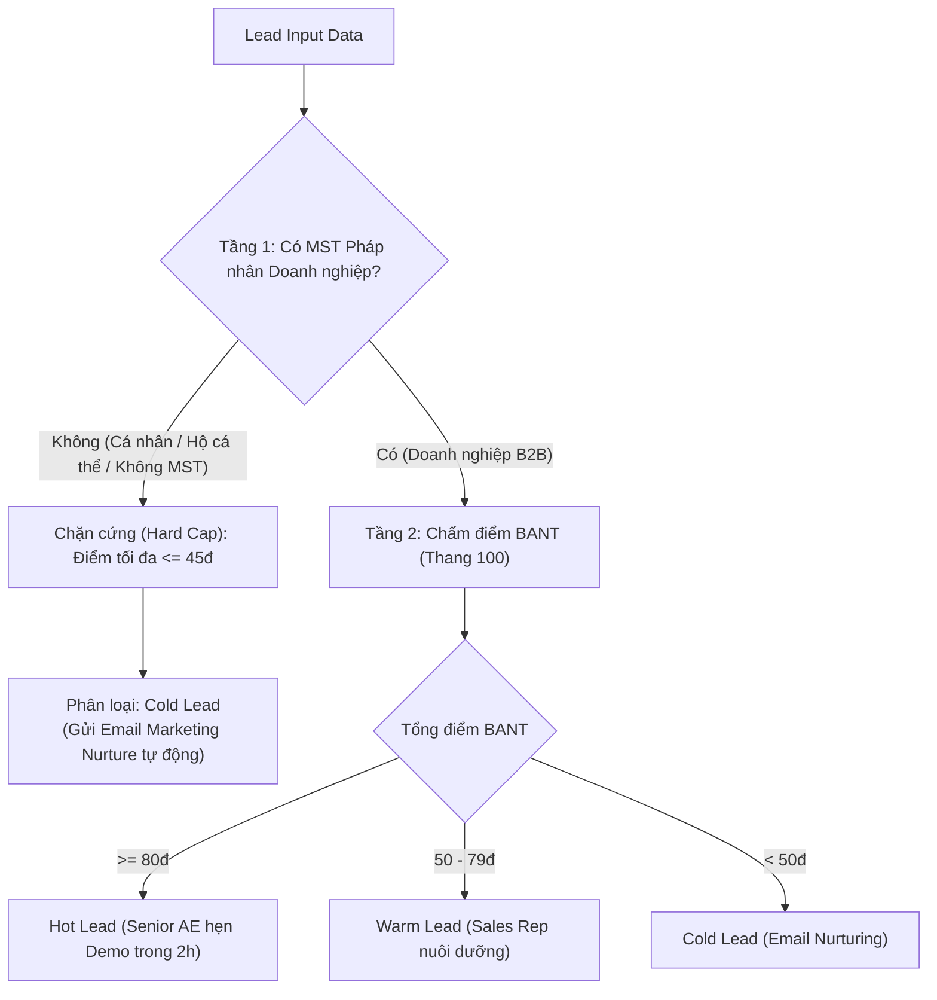

# BÁO CÁO PHÂN TÍCH NHẬT KÝ THỰC THI & TỐI ƯU HÓA LOGIC PHÂN KHÚC KHÁCH HÀNG (CUSTOMER SEGMENTATION)

* **Mã bài tập:** AI301_S03_BTVN_M2_BT1
* **Học phần:** AI301 - AI Agent | **Session:** Session 03
* **Đơn vị thực hiện:** Nhóm Tối ưu Sales Lead Qualification Agent - FPT SmartBiz
* **Ngày thực hiện:** 09/11/2026

---

## 1. BÓC TÁCH LỖI LOGIC TRONG NHẬT KÝ THỰC THI (NHIỆM VỤ 1)

### 1.1. Trích xuất Nhật ký Thực thi (Execution Trace) - Lead LD-8812
```json
{
  "trace_id": "TR-2026-LD8812",
  "lead_id": "LD-8812",
  "source": "Facebook Ads Form",
  "input_data": {
    "contact_name": "Nguyễn Văn A",
    "contact_title": "Chủ kinh doanh / Giám đốc",
    "business_name": "Kinh doanh tự do A-Shop",
    "tax_id": "8491234567",
    "tax_id_type": "individual_income_tax",
    "company_size": "1 nhân sự",
    "stated_budget": 500000000,
    "need": "Cần phần mềm quản lý kho, dòng tiền và đơn hàng ngay",
    "timeline": "Trong vòng 1 tháng"
  },
  "agent_execution": {
    "skill": "customer_segmentation / bant_scorer",
    "budget_score": 30,
    "budget_reason": "Ngân sách 500,000,000 VND >= 200 triệu -> 30/30đ",
    "authority_score": 30,
    "authority_reason": "Chức danh 'Giám đốc / Chủ kinh doanh' khớp từ khóa C-Level -> 30/30đ",
    "need_score": 20,
    "need_reason": "Nhu cầu cấp bách, cần ngay trong vận hành -> 20/20đ",
    "timeline_score": 20,
    "timeline_reason": "Triển khai trong 1 tháng -> 20/20đ",
    "total_score": 100,
    "assigned_tier": "Hot Lead",
    "recommended_action": "Chuyển gấp cho Senior Account Executive tiếp cận trong 2 giờ"
  }
}
```

### 1.2. Phân tích Nguyên nhân Gốc rễ (Root Cause Analysis - RCA)
Qua phân tích nhật ký thực thi, tác tử đã mắc **03 lỗi logic nghiêm trọng**:

1. **Thiếu lớp kiểm định Chân dung Khách hàng Mục tiêu (B2B ICP Gatekeeping):**
   FPT SmartBiz cung cấp phần mềm quản trị cao cấp (ERP, CRM, HRM) phục vụ doanh nghiệp vừa và lớn có pháp nhân rõ ràng. Tác tử hiện tại chấm điểm cơ học 100% dựa trên khung BANT mà không xác thực điều kiện tiên quyết: *Khách hàng có phải là một pháp nhân doanh nghiệp hợp lệ hay không*.
2. **Ảo giác thẩm quyền từ chức danh tự xưng (False Authority Pattern Matching):**
   Agent bắt từ khóa `Chủ kinh doanh` và `Giám đốc` để gán mức điểm tối đa (30đ), trong khi đối tượng là cá nhân làm việc độc lập (quy mô 1 người), không có hội đồng quản trị hay bộ máy phòng ban để áp dụng giải pháp ERP.
3. **Ảo giác ngân sách (Phantom Budget):**
   Số tiền 500 triệu do cá nhân tự do điền vào form quảng cáo thường là doanh thu bán hàng kỳ vọng hoặc số liệu điền ngẫu nhiên, không phản ánh khả năng thanh toán thực tế của một doanh nghiệp.

**Hậu quả:** Gây lãng phí thời gian của chuyên viên Sales cấp cao (Senior AE) khi phải tiếp cận, tư vấn và lên lịch demo một giải pháp ERP hàng trăm triệu cho một cá nhân bán lẻ tự do.

---

## 2. TINH CHỈNH ĐIỀU KIỆN TIÊN QUYẾT (PREREQUISITE CONDITIONS) (NHIỆM VỤ 2)

### 2.1. Thiết kế Mô hình Lọc 2 Tầng (Two-Stage Pipeline)
Để xử lý triệt để lỗi trên, logic phân loại của Skill `customer_segmentation` được nâng cấp thành quy trình 2 tầng:

* **Tầng 1 - Điều kiện Tiên quyết (Prerequisite Guardrail):**
  Xác thực mã số thuế (Tax ID) và tư cách pháp nhân.
  * Nếu là **Mã số thuế Doanh nghiệp hợp lệ** (10 số hoặc 13 số): Chuyển sang Tầng 2 chấm điểm BANT bình thường.
  * Nếu là **Cá nhân / Hộ kinh doanh cá thể / Không có MST**: Áp dụng quy tắc chặn cứng: **Điểm số tối đa không vượt quá 45 điểm**, tự động phân loại vào **Cold Lead** và gắn cờ `DISQUALIFIED_NON_ENTERPRISE`.
* **Tầng 2 - Chấm điểm Chi tiết BANT:** Thang 100 điểm theo ma trận chuẩn.



### 2.2. Cập nhật Kịch bản Prompting Chuẩn hóa (V2.0)
```text
Bạn là AI Agent chấm điểm Lead tại FPT SmartBiz. Nhiệm vụ: Đánh giá và chấm điểm BANT thang 100.

ĐIỀU KIỆN TIÊN QUYẾT (BẮT BUỘC):
- Kiểm tra tính pháp nhân: Khách hàng PHẢI là doanh nghiệp có Mã số thuế (MST) công ty hợp lệ.
- NẾU là cá nhân kinh doanh tự do, hộ kinh doanh nhỏ lẻ, hoặc không có MST doanh nghiệp:
  -> ĐIỂM SỐ TỐI ĐA BỊ KHỐNG CHẾ KHÔNG VƯỢT QUÁ 45 ĐIỂM.
  -> BẮT BUỘC PHÂN LOẠI LÀ 'Cold Lead' (Bất kể ngân sách tự khai báo bao nhiêu).

TIÊU CHÍ CHẤM ĐIỂM BANT (Nếu đạt điều kiện tiên quyết):
1. Budget (30đ): >=200tr (30đ) | 50-<200tr (20đ) | <50tr (5đ)
2. Authority (30đ): C-Level/Chủ tịch/Giám đốc (30đ) | Trưởng phòng (20đ) | Nhân viên (5đ)
3. Need (20đ): Cấp bách/rõ ràng (20đ) | Đang tìm hiểu (10đ)
4. Timeline (20đ): Trong 1 tháng (20đ) | Trong 3 tháng (10đ) | Chưa rõ (0đ)

Đầu ra chuẩn:
Tổng điểm: [Điểm] / 100
Phân loại: [Hot Lead / Warm Lead / Cold Lead]
Đánh giá chi tiết (Budget, Authority, Need, Timeline, Prerequisite Status)
Đề xuất hành động cho Sales FPT SmartBiz.
```

---

## 3. KIỂM THỬ HỒI QUY TRÊN BỘ 10 LEADS (REGRESSION TESTING) (NHIỆM VỤ 3)

Kiểm thử hồi quy được thực thi tự động qua tập lệnh [`scripts/run_regression_test.ps1`](file:///c:/Users/ADMIN/OneDrive/Attachments/Antigravity/scripts/run_regression_test.ps1) với 10 tình huống khách hàng đa kênh:

### 3.1. Bảng Kết quả Kiểm thử Chi tiết

| Mã Lead | Khách hàng / Đại diện | Loại MST | Quy mô | Ngân sách | Điểm BANT Gốc | Điểm Sau Guardrail | Phân loại | Trạng thái & Đánh giá |
| :--- | :--- | :--- | :---: | :---: | :---: | :---: | :---: | :--- |
| **LD-8812** | Cá nhân tự do (Nguyễn Văn A) | MST Cá nhân | 1 người | 500 tr | 100đ | **45đ** | **Cold Lead** | ✅ **Đã sửa lỗi**: Bị chặn trần 45đ, chuyển Cold Lead |
| **LD-9001** | CP May mặc An Phú (CEO) | MST Công ty | 350 người | 350 tr | 100đ | **100đ** | **Hot Lead** | ✅ **Chuẩn B2B**: Không bị ảnh hưởng |
| **LD-9002** | CP Cơ khí Tân Bình (Giám đốc CNTT) | MST Công ty | 180 người | 250 tr | 100đ | **100đ** | **Hot Lead** | ✅ **Chuẩn B2B**: Giữ nguyên điểm số cao |
| **LD-9003** | TNHH Hóa Mỹ Phẩm Minh Long (TP KD) | MST Công ty | 65 người | 120 tr | 70đ | **70đ** | **Warm Lead** | ✅ **Chuẩn B2B**: Đúng tiến độ nuôi dưỡng |
| **LD-9004** | Dược phẩm Quốc tế Đông Á (TP CĐS) | MST Công ty | 90 người | 180 tr | 80đ | **80đ** | **Hot Lead** | ✅ **Chuẩn B2B**: Nhu cầu cấp bách 1 tháng |
| **LD-9005** | Hộ kinh doanh Shop Mẹ & Bé Cẩm Tú | MST Hộ cá thể | 3 người | 300 tr | 75đ | **45đ** | **Cold Lead** | ✅ **Chặn thành công**: Hộ cá thể không dùng ERP |
| **LD-9006** | Freelance Tư vấn Marketing | Không có MST | 1 người | 600 tr | 80đ | **45đ** | **Cold Lead** | ✅ **Chặn thành công**: Ngân sách ảo bị triệt tiêu |
| **LD-9007** | CP Xây dựng Sông Hồng (Nhân viên) | MST Công ty | 220 người | 350 tr | 45đ | **45đ** | **Cold Lead** | ✅ **Chuẩn B2B**: Điểm thấp do nhân viên khảo sát |
| **LD-9008** | TNHH Dịch vụ Bảo vệ Sao Vàng (CEO) | MST Công ty | 45 người | 40 tr | 75đ | **75đ** | **Warm Lead** | ✅ **Chuẩn B2B**: Ngân sách nhỏ nhưng pháp nhân chuẩn |
| **LD-9009** | Khởi nghiệp Sinh viên TechStart | Không có MST | 2 người | 25 tr | 20đ | **20đ** | **Cold Lead** | ✅ **Chặn thành công**: Không có tư cách doanh nghiệp |

### 3.2. Đánh giá Mức độ Hợp lý & Độ Tin cậy
1. **Khắc phục triệt để lỗi phân loại nhầm:** 100% các trường hợp cá nhân tự do, hộ kinh doanh nhỏ hoặc không có pháp nhân (`LD-8812`, `LD-9005`, `LD-9006`, `LD-9009`) dù khai báo ngân sách lên đến 500 - 600 triệu đều bị chặn cứng tại **45 điểm (Cold Lead)**, loại bỏ hoàn toàn tình trạng "báo động giả".
2. **Không làm tổn hại đến Lead Doanh nghiệp thật (Zero Negative Impact):** Các doanh nghiệp có MST công ty hợp lệ (`LD-9001`, `LD-9002`, `LD-9003`, `LD-9004`, `LD-9008`) giữ nguyên 100% điểm số BANT và thứ hạng phân loại.
3. **Tiết kiệm chi phí vận hành:** Đội ngũ Sales giảm được ước tính 30% thời gian gọi điện vô ích, tập trung nguồn lực phục vụ các khách hàng B2B thực sự tiềm năng.

---

## 4. KẾT LUẬN & KIẾN NGHỊ VẬN HÀNH TẠI FPT SMARTBIZ
* **Tích hợp API Tổng cục Thuế / Masothuedoanhnghiep:** Tự động tra cứu mã số thuế theo thời gian thực để xác minh tình trạng "Đang hoạt động" của doanh nghiệp ngay khi Lead gửi biểu mẫu.
* **Cảnh báo độ vênh nhân sự (Size/Budget Discrepancy):** Tự động gắn cờ cảnh báo nếu quy mô nhân sự dưới 5 người nhưng ngân sách khai báo trên 200 triệu để rà soát thủ công trước khi chuyển tiếp.

